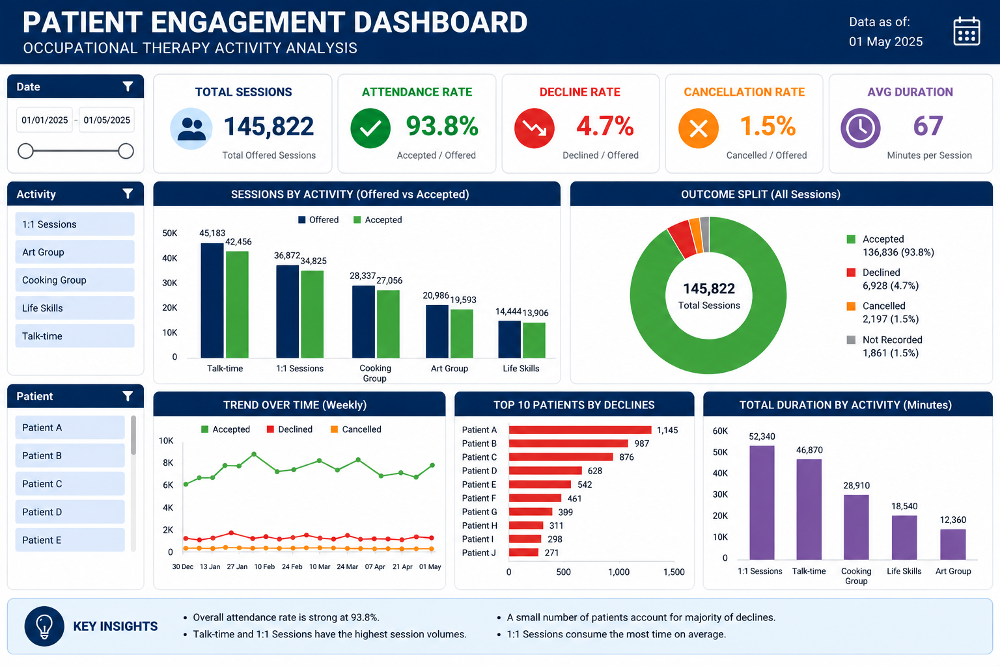

# Occupational Therapy Activity & Patient Engagement Analysis

**Microsoft Excel · Formulas · Data Validation · Charts · Operational Analytics**

An Excel dashboard examining activity participation, session outcomes and attended minutes. The public workbook recreates the analytical approach of a workplace project using entirely synthetic records.

*Illustrative dashboard preview. The editable Excel workbook is linked below.*

## Business problem

Clinical teams need a clear view of which occupational therapy activities are accepted or declined, how participation varies over time and how much session time is attended. This information can support discussions about activity planning and engagement.

## Business solution

Developed an Excel dashboard combining session counts, outcome comparisons, activity-level participation and attended minutes. Year, Activity and Time of Day dropdowns allow users to explore different groups of sessions.

## Analysis covered

- Total activity sessions and recorded outcomes.
- Accepted, declined, cancelled and unrecorded sessions.
- Participation across activity types.
- Monthly engagement patterns.
- Morning, Afternoon and Evening comparisons.
- Minutes attended in accepted sessions.

## Key observations

In the public synthetic workbook:

1. **Accepted sessions form the largest outcome group.**
2. **Wellbeing Group has the most accepted sessions** among the example activity types.
3. **Cancelled and unrecorded sessions are separate outcomes**, supporting a clearer distinction between declined activities and other reasons for non-participation.

## Operational recommendations

- Compare participation across activity types and time groups when reviewing schedules.
- Review reasons for declined, cancelled and unrecorded sessions separately.
- Consider attended minutes alongside session counts when assessing engagement.

## Use the Excel dashboard

1. Download [Occupational_Therapy_Interactive_Dashboard.xlsx](Occupational_Therapy_Interactive_Dashboard.xlsx) and open it in desktop Excel.
2. Open the **Dashboard** sheet.
3. Use the **Year** dropdown in **Y6**, **Activity** in **Y10** and **Time of Day** in **Y14**.
4. Select **All** in each dropdown to view the complete demonstration, then adjust the selections to compare groups.

The workbook includes **Dashboard**, **Synthetic_Data**, **Chart_Data** and **Instructions** sheets, with native charts and formula-based summaries.

[Read the project report](REPORT.md) · [View the synthetic activity records](synthetic_occupational_therapy.csv)

## Data note

All public records and figures are synthetic and differ from the confidential workplace analysis. They do not describe actual patients or service performance.

---

**Oluwatobiloba Olufowobi**  
[LinkedIn](https://www.linkedin.com/in/olufowobi365/) · [GitHub](https://github.com/OlufowobiJosh)
